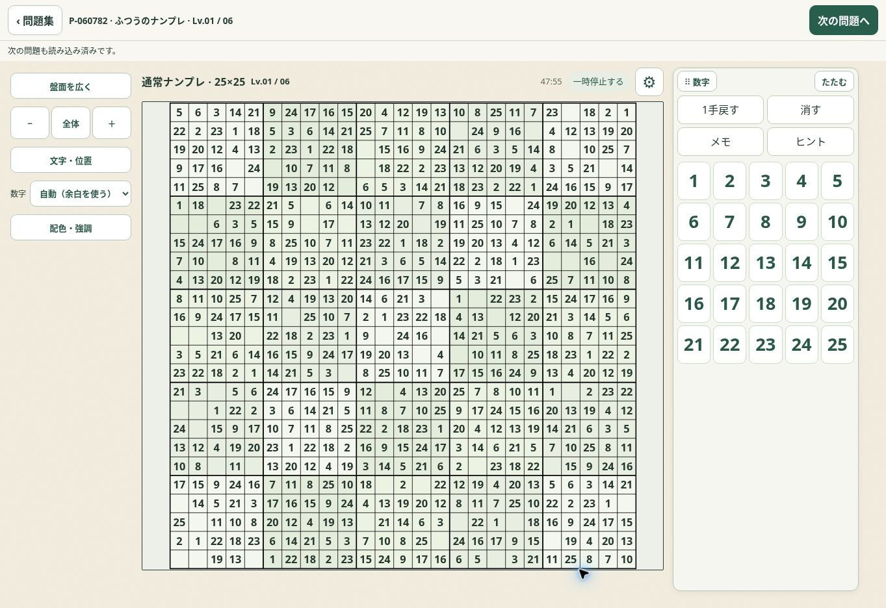
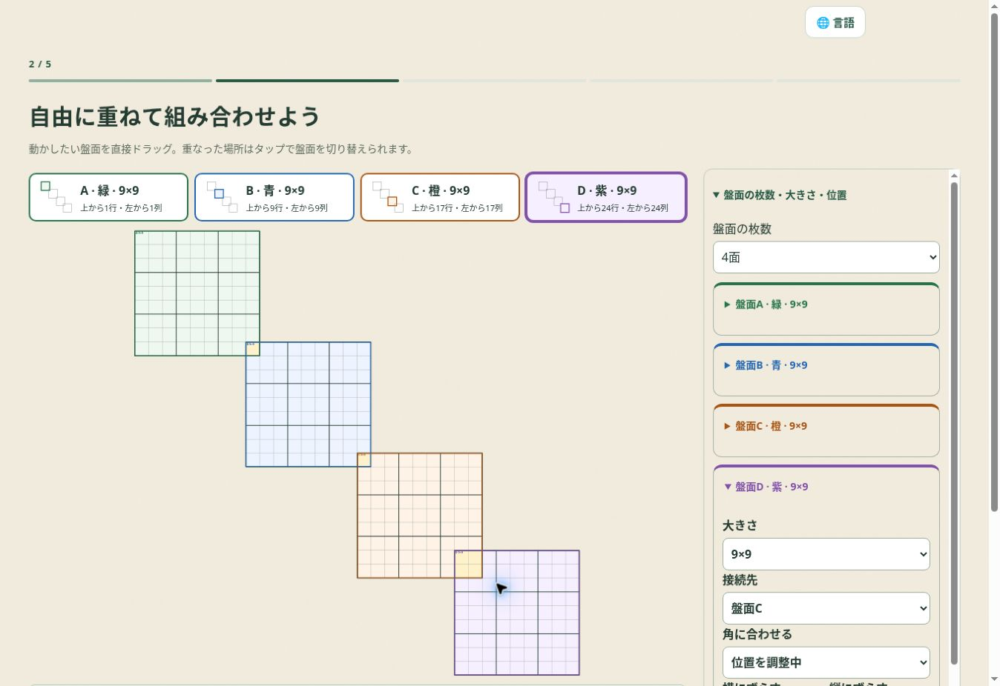

# Board workspace and colors

Release 2026.11.01.68 uses the same workspace and color preferences for generated puzzles and the ready-to-play collection. Wide screens automatically put controls beside the board; small screens keep a bottom keypad. Users can choose top, bottom, either side, or a draggable floating panel. The original controls are moved, retaining their event handlers, input state and saves. Automatic placement initially fits the whole board; the existing zoom and readable-size controls remain available.

The multi editor expands its outer container and uses a large preview beside a readable, collapsible settings column. Pointer hit testing selects the board under the pointer directly. Tapping a shared region cycles containing boards. Any board, including A, can move. Other boards keep their relative coordinates; invalid or disconnected drafts remain editable and display a reason before generation.

`board-comfort-model.js` validates shared preferences and builds region membership for regular, rectangular, jigsaw and mixed boards. `board-comfort.js` supplies templates, individual region colors, independent selected/guide/matching-digit colors, a 1–15 second timer and outside-press behavior. Hiding highlighting changes its visual layer while keeping the selected cell, keyboard input, error marks, notes and puzzle data. Preferences use `np-board-comfort-v1`; the existing workspace key is retained. Settings synchronize between players and are included in site backup keys. Printed boards retain their measured styles.

`prepare-board-comfort-release.mjs` preserves published releases, refreshes the source app with the localization transforms, adds the shared modules, and updates integrity hashes. The exporter also retains the new modules.

Validation: `check-nanpure-board-comfort.cjs` exercises the actual model and runtime with isolated storage and a deterministic clock. `check-nanpure-comfort-browser.cjs` checks real colors and controls on desktop, phone and landscape collection players and a generated 16×16 board. The mixed-layout test additionally covers grabbing A and cycling a shared area without changing the draft.

## Collection audit, 1 November 2026

`collection-100k/audit-playable.cjs` verifies all 4,561 downloadable packs, their hashes, all 104,619 record IDs and condition fields, and 604 representative opens through the actual collection engine. All were available. The Sudoku collection exposes 22 rules, 294 conditions and 98,279 puzzles; 6,340 cross-balance puzzles are owned by Pareasobi. All 294 Sudoku conditions were reachable in the filter regression.

Comparing stocked conditions with the current batch generator finds 109 unstocked Sudoku conditions: jigsaw 39, killer 43, neighbor 19 and step 8. These are absent stock conditions, rather than broken choices in the catalog. Full condition-level results are in `collection-availability-20261101.json`. This comparison covers the enumerated batch configurations; arbitrary custom multi layouts are not a finite stock catalog.

The compact play header retains the rule and size. The side controls retain the saved minimum text size, and short landscape layouts give the keypad the full available height. The generated player shares reversible translation registrations with the collection.

