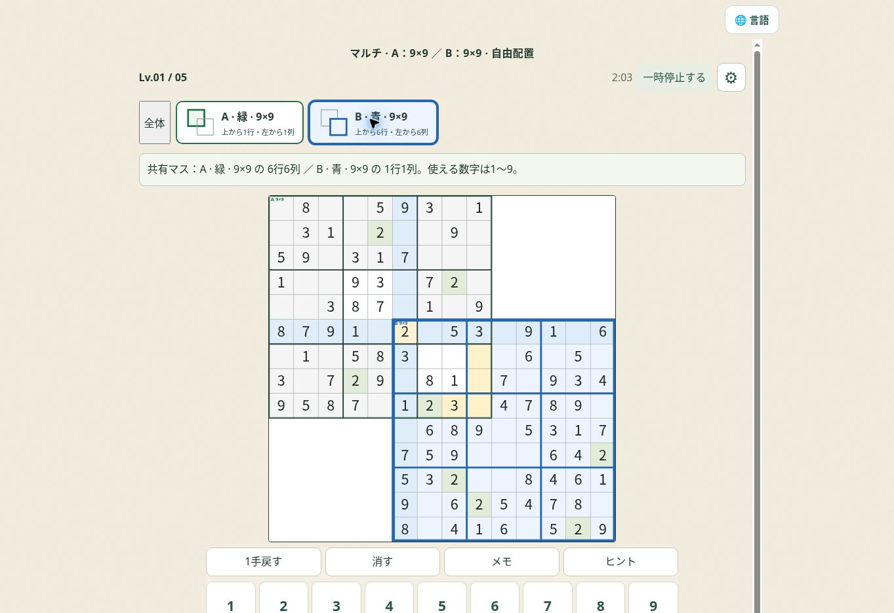

# Mixed-size multi Sudoku

Release 2026.11.01.67 extends free layouts to arbitrary cell-aligned overlaps. Users can drag a selected board, move it with four arrow buttons, or enter horizontal and vertical offsets relative to an earlier parent board. At least one cell must overlap the parent; intersections with other boards and three-way shared cells are allowed. Corner shortcuts and existing version 2 corner saves remain supported. Identical duplicate boards, disconnected placements and overlaps with insufficient digit domains are rejected before generation. Layouts with no compatible completion report an error. Free generation stops with an actionable retry message when its search budget is exhausted.

Eight consistent board colors, color names, location mini maps and top-left row/column positions identify each board in both configuration and play. Selecting a board emphasizes its outer and block borders. Selecting a cell reports every containing board and its local row/column. The same SVG colors and contours are used in saved thumbnails and printing. The finder offers every component size and a free-layout shape option. Printing uses the greater of the physical width and height so rectangular layouts fit in single, packed, booklet and tiled output.

The available sizes are 4, 6, 8, 9, 10, 12, 14, 15, 16, 18, 20, 21, 22, 24 and 25. A board uses 1 through its own size. Shared cells use the intersection of the participating boards' number ranges. Each board records its size and rectangular block geometry. `p.n` is the maximum board size, and `multiVersion: 2` distinguishes this schema from existing version 1 saves.

The new engine is in `scripts/client-overrides/public/notebook/mixed-multi.js`. It keeps the original engine's version 1 APIs and validation. Version 2 uses variable-size units and per-cell domains for Latin-template construction with a bounded global constraint-search fallback, logical grading, exact uniqueness verification, SVG rendering, progress sanitization and generation identity. The five grades retain the original deduction caps; all-4×4 combinations expose only the two basic grades. Generation never substitutes a lower grade. Every accepted puzzle must require shared information for at least one board.

`core-mixed-multi` is included after `generator-source` in the notebook and both worker loaders. The print document loads the same engine after `common.js`. The exporter preserves these entry points. Candidate memos, hints, video/completion groups, resume queues, backup/restore and print rendering use the version 2 geometry.

Run `node scripts/prepare-mixed-multi-release.mjs` to rebuild release 66, then `node scripts/prepare-mixed-overlap-release.mjs` to rebuild release 67 from that retained base. It preserves prior versioned directories. Run `node scripts/check-nanpure-mixed-multi.cjs` to verify all 15 sizes, all grades, preset and free layouts, direct per-board solution checks, exact uniqueness, no-guess solving, shared dependency, candidates, compressed backup/restore, five print modes, arbitrary and triple overlaps, editor drag/cancel, board identity, finder facets, resume identity and version 1 compatibility. The check is also part of the Pages workflow.

