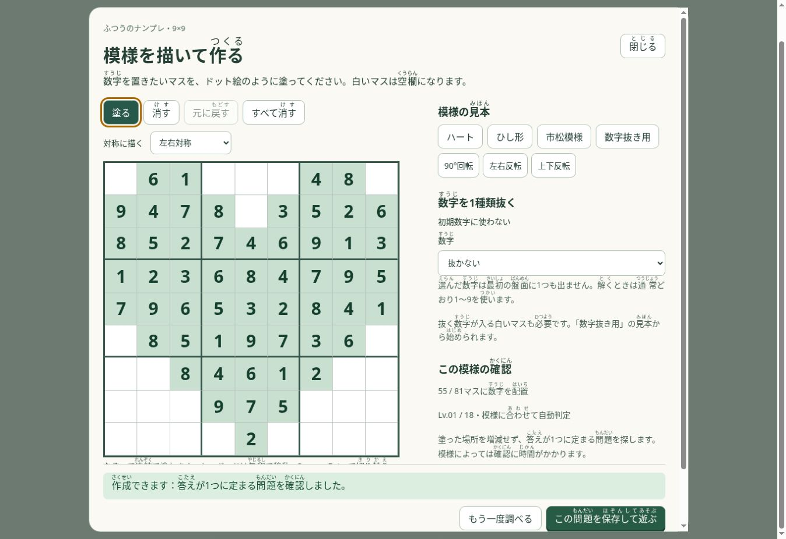
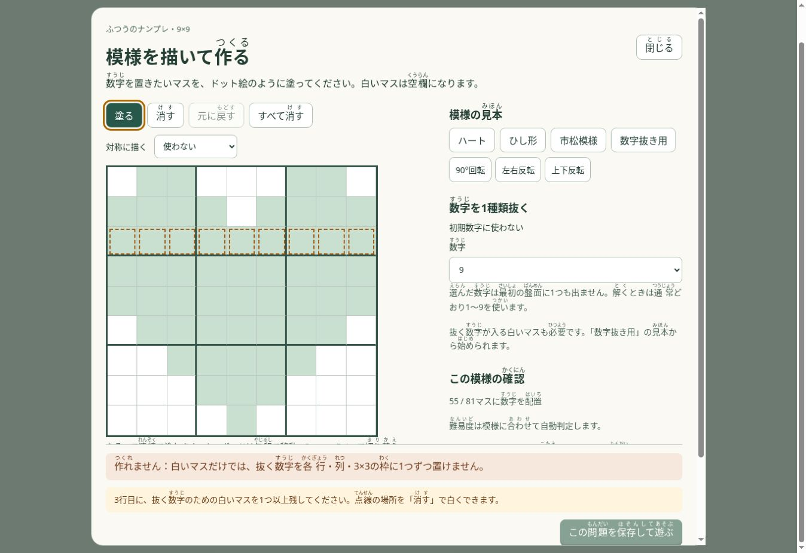

# 数理を使った模様指定の改善

9×9の模様づくりを対象に、研究の一次資料を調べて改善しました。

## 数式と実装の対応

各マス $(r,c)$ に数字 $d$ を置くかを $x_{r,c,d}\in\{0,1\}$ とすると、普通のナンプレは次を同時に満たします。

$$\sum_d x_{r,c,d}=1,\quad\sum_c x_{r,c,d}=1,\quad\sum_r x_{r,c,d}=1,\quad\sum_{(r,c)\in B}x_{r,c,d}=1.$$

順に、各マス・各行の数字・各列の数字・各3×3枠の数字に関する条件です。選択肢は $9^3=729$、条件は $4\cdot81=324$ です。各候補は4条件を満たす完全被覆問題として扱えます。

今回の確認処理はAlgorithm XとDancing Linksの考え方で独立に実装しました。候補の少ない条件から分岐し、探索中の変更は逆順に戻します。2解目を見つけたら多解と判定し、探索上限や時間切れでは不可能と判定しません。難易度は従来の人向け論理解法で別途評価します。

模様 $M$ と完成盤面 $S$ から初期数字を $P_{r,c}=M_{r,c}S_{r,c}$ とします。マスクは勝手に増減しません。数字 $k$ を抜くときは $S_{r,c}=k\Rightarrow M_{r,c}=0$ を守ります。

## 利用者向けの改善

- 左右・上下・点・上下左右対称に描く設定を追加しました。設定後に塗るマスに適用し、今ある模様はそのままです。
- 90度回転、左右反転、上下反転と、それらの取り消しを追加しました。
- 初期数字が17未満なら不足数を表示します。17以上でも成立が保証されるわけではありません。
- 同じ帯の空き2行・2列や、抜く数字の白い場所がない行・列・枠を点線で示し、修正の目安を表示します。修正後に再検査します。
- 8通りの正方形の対称変換で、検証済みの開始盤面を再利用します。対称変換で行・列・枠の条件と解の一意性が保たれることを利用した、今回の実装上の判断です。
- 「作成のコツ・数理のポイント」に、初期数字数と数字抜きの条件、研究のリンクを載せました。

## 検証

`node scripts/check-nanpure-pattern-math.cjs` は、固定した121ケースで旧版と新処理の解の数を比較し、さらに既存の独立したナンプレエンジンとも照合します。0解・唯一解・多解・17数字の唯一解・時間切れ・探索上限、32通りの変換済み見本、対称位置と不成立箇所を確認します。

手元の一測定は別添JSONのとおりです。探索回数は19,362→7,705回、実行時間は約102→23msでした。121ケースの測定結果であり、端末やすべての模様に対して同じ倍率を保証するものではありません。速度を根拠に不可能と断定することはありません。

## 一次資料

1. Donald E. Knuth, *Dancing links* (2000): https://arxiv.org/abs/cs/0011047 。完全被覆と探索の可逆な更新の考え方。公式の数独プログラム一覧: https://www-cs-faculty.stanford.edu/~knuth/programs.html
2. Gary McGuire, Bastian Tugemann, Gilles Civario, *There is no 16-Clue Sudoku* (2012/2013): https://arxiv.org/abs/1201.0749 。普通の9×9で唯一解を持つ問題の初期数字数の下限。
3. Kohei Nishikawa, Takahisa Toda, *Exact Method for Generating Strategy-Solvable Sudoku Clues* (2020): https://arxiv.org/abs/2005.14098 。指定位置での生成と人向け解法で解けることを扱う研究です。今回その論文の制約生成器全体を実装したものではありません。

## 画面確認

Cloud Browserで、回転後の唯一解確認、点線の修正案内、盤面と案内が重ならない配置を確認しました。

