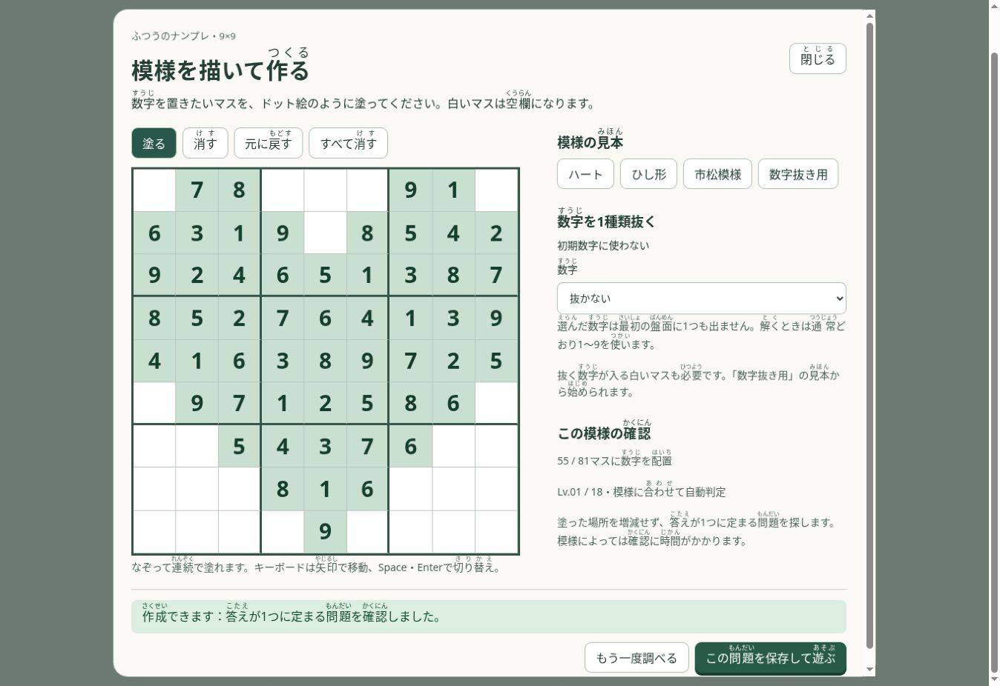

# 9×9の模様指定生成

「自由に遊ぶ → 問題を作る → 模様を描いて作る」で利用できます。通常の9×9の難易度選択からも開けます。

- 塗った全マスを初期数字にし、白い全マスを空欄にします。模様を自動で増減しません。
- 塗る・消す・ストローク単位の元に戻す・矢印キーとSpace/Enterに対応します。
- 初期数字から1種類の数字を除けます。解答では1〜9をすべて使います。
- 下書きの模様と除外数字を端末に保存します。
- Workerを編集ごとに破棄し、古い結果が保存されることを防ぎます。
- 完成盤面を無作為に生成し、指定マスクで切り出して独立した数独解探索で唯一解を確認します。保存時にもマスク・除外数字・解答・唯一性を再検証します。
- 難易度は既存の論理解法評価で自動判定し、評価できない唯一解には「難易度未判定」と表示します。既存の難易度生成を変更しません。

## 成立状況

「確認中」「作成できます」「作れません」「未確認」を区別します。探索の時間切れ・試行上限は未確認であり、不可能とは表示しません。もう一度調べると、模様を変えずに探索時間を延ばします。

不成立の根拠は17マス未満、同じ帯の数字なし2行（または2列）の交換対称性、および除外数字を白マスに各行・列・枠1つずつ置く方法が存在しない場合です。81マスすべてを選んだ場合は遊ぶ空欄を残すよう案内します。

17手がかり未満の不可能性の一次資料: Gary McGuire, Bastian Tugemann, Gilles Civario, *There is no 16-Clue Sudoku* (2012), https://arxiv.org/abs/1201.0749

## 検証

`node scripts/check-nanpure-pattern.cjs` は33問のマスク完全一致・既存エンジンでの唯一解・1〜9それぞれの数字除外・不成立と探索上限の区別・改変候補の拒否を確認します。

`node scripts/check-nanpure-pattern-browser.cjs _site` はCIでWorker・ドラッグ・元に戻す・キーボード・古いWorkerの取消・下書き復元・保存後の再読込をデスクトップと390px幅で確認します。

Cloud Browserで実画面の連続描画、9の除外、保存後のプレイ確認画面、下書き復元を確認しました。

